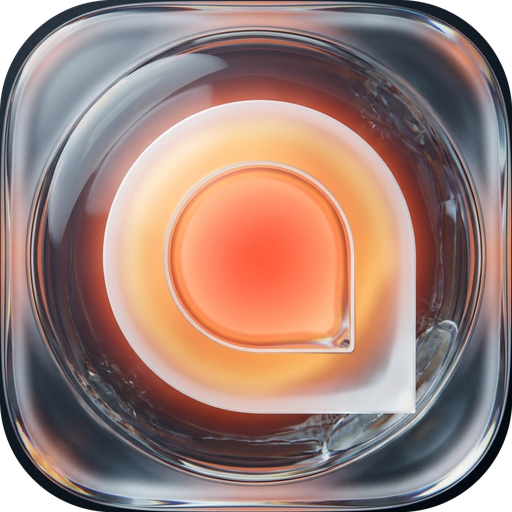
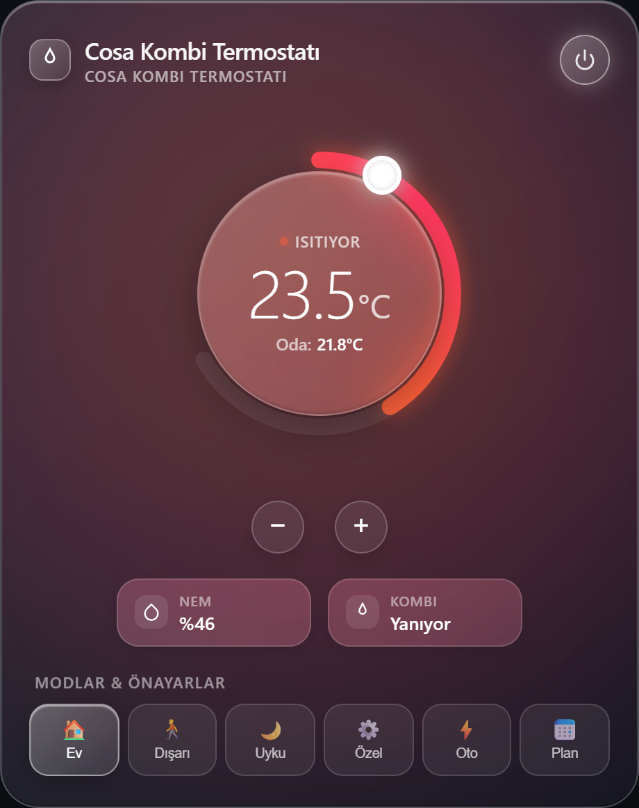
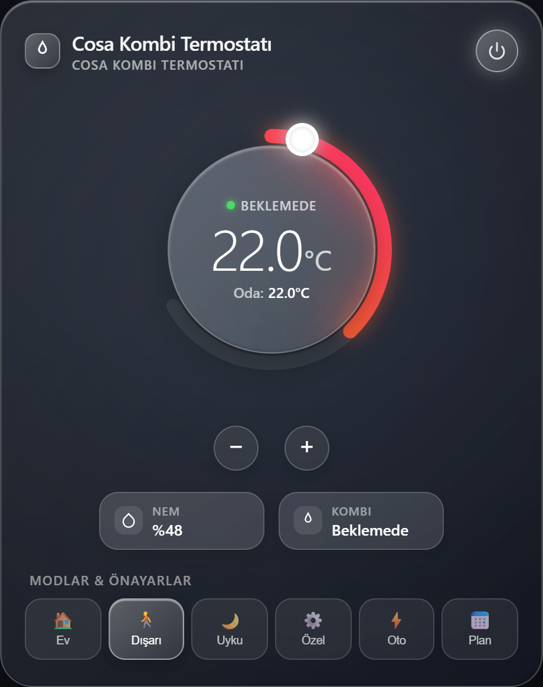
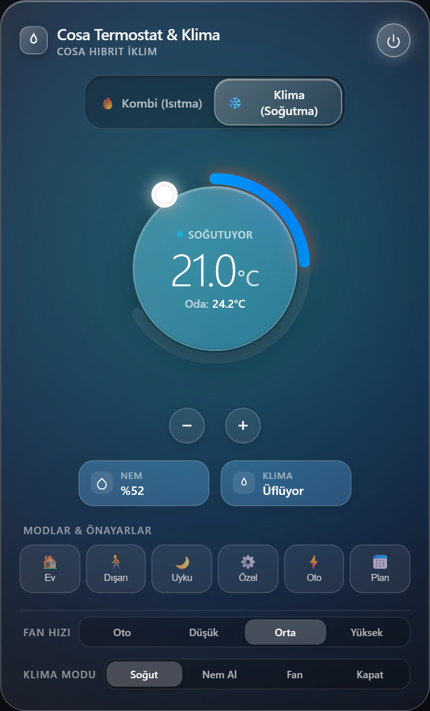
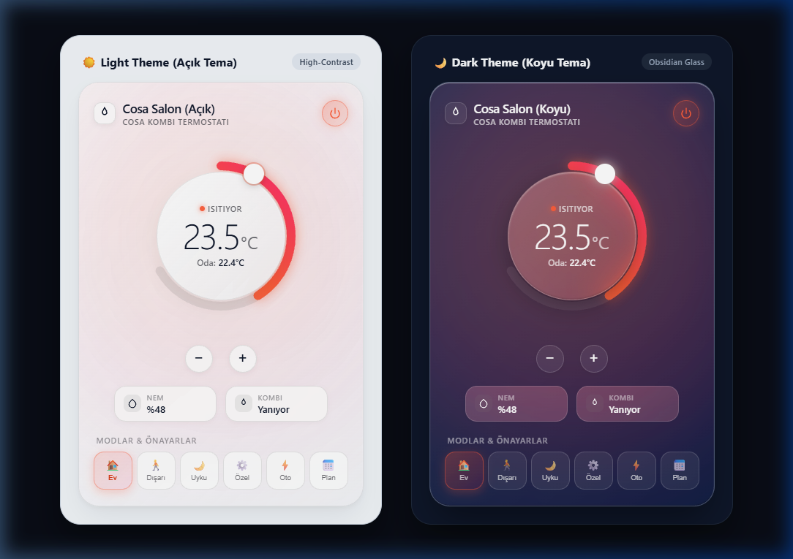

<p align="center">
  <a href="https://github.com/alte-dev/ha-cosa-thermostat-liquid-glass/releases"></a>
  <a href="https://github.com/hacs/default"></a>
  <a href="https://github.com/alte-dev/ha-cosa-thermostat-liquid-glass"></a>
  <a href="https://github.com/alte-dev/ha-cosa-thermostat-liquid-glass/blob/main/LICENSE"></a>
</p>

<p align="center">
  
</p>

<h1 align="center">🔥❄️ Liquid Glass Cosa Thermostat Card for Home Assistant</h1>

<p align="center">
  <a href="README.md"><strong>English</strong></a> |
  <a href="README.tr.md">Türkçe</a>
</p>

A modern, futuristic **Liquid Glass Lovelace Card** for **Cosa Smart Thermostats** (Combi Boiler & Air Conditioner) and Home Assistant climate entities. Built with **TypeScript**, **Lit**, and **Vite**.

Designed to work seamlessly with the [Aykut Vurmaz Cosa Integration](https://github.com/aykutvr/smartcosa-home-assistant-integration) or any generic Home Assistant climate entity.

---

## 📸 Screenshots & Card Preview

### 🔥 Operating Modes

| 🔥 Combi Heating (Default) | 🌙 Combi Idle / Standby | ❄️ Air Conditioner (Optional Hybrid) |
|:---:|:---:|:---:|
|  |  |  |

### 🌓 Automatic Light & Dark Theme Support

The Liquid Glass card automatically detects your Home Assistant dashboard theme and dynamically adapts its glass refraction, background opacity, and high-contrast typography for flawless legibility in both light and dark modes:

<p align="center">
  
</p>

---

## 🌟 Key Features

- 🌓 **Adaptive Light & Dark Theme:** Seamlessly auto-adapts to Home Assistant's theme with high-contrast text and crisp glassmorphism, or manually customizable via `theme_mode: auto | light | dark`.
- 💎 **Liquid Glassmorphism:** Deep optical blur (`backdrop-filter: blur(36px)`), specular light refraction borders, and multi-tier translucent glass discs.
- 🌈 **Dynamic Thermal Luminescence (Ambient Aura):**
  - **Heating Mode:** Radiant amber/ruby fiery backlight with thermal pulse animation when combi is burning gas.
  - **Cooling Mode:** Glacial electric cyan and arctic-blue backlight.
  - **Idle / Standby:** Calm emerald or sleek obsidian slate glass.
- 🎛️ **240° Precision Circular Dial:** Touch and mouse draggable smooth arc with glowing progress track and 0.1°C / 0.5°C micro-adjustment buttons.
- 🔥 **Combi Heating by Default (Pure Mode):** If you only have a Combi boiler thermostat, the AC toggle is **completely hidden** by default (`show_ac: false`).
- ❄️ **Optional AC Cooling Mode:** For Cosa hardware with IR air conditioner support, enable `show_ac: true` to get the hybrid Combi ↔ AC switcher, fan speeds (Auto, Low, Med, High), and AC modes (Cool, Heat, Dry, Fan).
- ⚡ **Optimistic UI:** Instantaneous tactile feedback without waiting for cloud polling round-trips.
- 🎯 **Presets:** Home, Away, Sleep, Custom, Auto, and Weekly Schedule.
- 💧 **Environmental Metrics:** Ambient temperature, relative humidity percentage, and live flame ignition status.

---

## 📋 Prerequisites

To control your Cosa thermostat in Home Assistant, install the Cosa integration:
* [SmartCosa Home Assistant Integration (aykutvr/smartcosa-home-assistant-integration)](https://github.com/aykutvr/smartcosa-home-assistant-integration)

Once installed and configured, you will have the `climate.cosa_thermostat` entity (and `climate.cosa_thermostat_ac` if AC is enabled).

---

## 🚀 Installation

### Method 1: HACS (Recommended)
1. Open **HACS** in your Home Assistant sidebar.
2. Go to **Frontend**.
3. Search for **Cosa Thermostat Liquid Glass Card** (or add this repository URL as a Custom Repository with type **Dashboard / Lovelace / Plugin**).
4. Click **Download**.
5. Reload your dashboard when prompted.

### Method 2: Manual Installation
1. Download `cosa-thermostat-card.js` from the [Latest Release](https://github.com/alte-dev/ha-cosa-thermostat-liquid-glass/releases).
2. Copy `cosa-thermostat-card.js` to your Home Assistant `<config>/www/` directory.
3. In Home Assistant, navigate to **Settings** > **Dashboards** > click the three dots in the top right > **Resources**.
4. Click **Add Resource**:
   - **URL:** `/local/cosa-thermostat-card.js`
   - **Resource Type:** `JavaScript Module`
5. Refresh your browser.

---

## 🎨 Lovelace Card Setup

Add a **Manual Card** to your Lovelace dashboard with the following YAML:

### 1. Combi Boiler Thermostat (Default - No AC):
```yaml
type: custom:cosa-thermostat-card
entity: climate.cosa_thermostat
name: Living Room Thermostat
temp_step: 0.5
show_ac: false  # Default is false: displays clean combi-only view
show_ambient_glow: true
```

### 2. Combi & Air Conditioner (Hybrid):
```yaml
type: custom:cosa-thermostat-card
entity: climate.cosa_thermostat
ac_entity: climate.cosa_thermostat_ac
name: Living Room Climate
temp_step: 0.5
show_ac: true   # Enables the Combi / AC switcher
show_ambient_glow: true
```

### Card Configuration Options

| Option | Type | Default | Description |
| :--- | :--- | :--- | :--- |
| `type` | `string` | **Required** | `custom:cosa-thermostat-card` |
| `entity` | `string` | **Required** | Combi climate entity (`climate.cosa_thermostat`) |
| `name` | `string` | `Cosa Thermostat` | Custom card title |
| `show_ac` | `boolean` | `false` | **AC toggle.** Keep `false` if you only have a combi boiler. |
| `ac_entity` | `string` | `undefined` | AC entity ID (`climate.cosa_thermostat_ac`) |
| `temp_step` | `number` | `0.5` | Temperature adjustment step (`0.1`, `0.5`, or `1.0`) |
| `show_ambient_glow` | `boolean` | `true` | Dynamic thermal ambient glow behind the card |
| `liquid_glass` | `boolean` | `true` | Frosted liquid glass style. Set to `false` to match standard Home Assistant card backgrounds. |
| `theme_mode` | `string` | `auto` | Theme appearance: `auto` (adapts to HA Light/Dark mode automatically), `light`, or `dark`. |
| `glass_style` | `string` | `liquid-glass` | Card aesthetic style |

---

## 💻 Developer & Build Workflow

Built using **Node.js**, **TypeScript**, **Lit**, and **Vite**:

```bash
# Install dependencies
npm install

# Run development server with Vite HMR:
npm run dev

# Compile TypeScript and build production bundle:
npm run build
```

The build command outputs the minified bundle to `dist/` and automatically synchronizes `cosa-thermostat-card.js` (root) and `www/cosa-thermostat-card.js`.

---

## 📜 Changelog & Releases

See the complete [CHANGELOG.md](CHANGELOG.md) for detailed release history.

* **[v1.1.1](https://github.com/alte-dev/ha-cosa-thermostat-liquid-glass/releases/tag/v1.1.1) (2026-11-04):** Registration guards and enhanced Lovelace self-healing rebuild.
* **[v1.1.0](https://github.com/alte-dev/ha-cosa-thermostat-liquid-glass/releases/tag/v1.1.0) (2026-11-04):** Restructured into a dedicated HACS Lovelace plugin card, decoupled backend integration to `integration-archive` branch, added MIT copyright attribution, streamlined CI/build.
* **[v1.0.0](https://github.com/alte-dev/ha-cosa-thermostat-liquid-glass/releases/tag/v1.0.0) (2026-10-27):** Initial public release with full liquid glassmorphism, dynamic thermal aura, and light/dark theme adaptation.

---

## ⚖️ License & Attribution

- Licensed under the **MIT License** - see the [LICENSE](LICENSE) file for details.
- Special thanks to Aykut Vurmaz ([aykutvr](https://github.com/aykutvr)) for the original Home Assistant Cosa integration.

*Disclaimer: This Lovelace card is an independent community project and is not officially associated with or endorsed by Nuvia A.Ş. (Cosa).*
